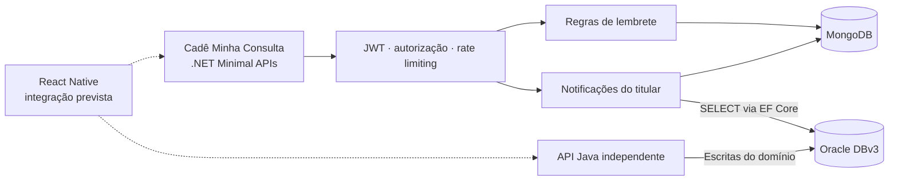

# Cadê Minha Consulta

**Backend .NET para acompanhamento de consultas públicas e notificações internas ao cidadão.**


[Execução](#executar-o-projeto) · [Endpoints](#endpoints-rest) · [Testes](#testes-e-evidências) · [Demonstração](docs/Roteiro-Demonstracao.md)

## CitizenTech e propósito

Faltas em consultas do SUS prejudicam o atendimento e o aproveitamento de horários disponíveis. O Cadê Minha Consulta propõe dar ao cidadão acesso ao acompanhamento de suas consultas e às informações necessárias para interagir com o serviço público.

Este repositório implementa a API .NET da solução. Ela consulta os estados das consultas no Oracle, mantém notificações e marcações de leitura no MongoDB e permite ao gestor administrar regras de lembrete.

### Funcionalidades disponíveis

- Consultar notificações do titular autenticado a partir dos estados `AGENDADA`, `CONFIRMADA` e `CANCELADA` observados no Oracle.
- Marcar uma notificação própria como lida, com repetição segura.
- Criar, listar, consultar, editar e excluir regras de lembrete.
- Tratar o POST repetido por meio de idempotência durável.
- Documentar as rotas no Swagger e monitorar API e bancos com Health Checks.

As notificações são atualizadas quando o cliente consulta a API. `observedAtUtc` registra a primeira observação daquele status. Estados intermediários entre duas consultas podem passar sem registro. As regras estão disponíveis para consulta e administração. Envio de mensagens e agendamento automático ficam fora da implementação atual.

## Arquitetura



| Componente | Responsabilidade |
|---|---|
| Java | Usuários, pacientes, consultas, confirmações, cancelamentos, fila e realocação, incluindo suas escritas no Oracle. |
| .NET | Leitura de consultas, notificações internas, marcação de leitura e CRUD de regras. |
| Oracle DBv3 | Fonte relacional das consultas. O contexto EF Core lê os campos necessários e bloqueia `SaveChanges`. |
| MongoDB | Coleções `notifications` e `reminder_rules`, com índice único `_id_`. |
| Mobile | Consumir as APIs com JWT. A chamada real pelo React Native depende do projeto da equipe Mobile. |

A validação JWT é local. O backend não faz chamadas HTTP à API Java. O [contrato Mobile](docs/Contrato-Mobile.md) reúne as URLs por ambiente e uma tela de exemplo, ainda sem execução no aplicativo.

## Tecnologias e estrutura

| Tecnologia | Uso |
|---|---|
| C# e ASP.NET Core 10 | Minimal APIs, DI, JWT, rate limiting e Health Checks. |
| EF Core 10 e Oracle.EntityFrameworkCore | Mapeamento e consultas ao Oracle DBv3. |
| MongoDB.Driver | Persistência e operações atômicas por documento. |
| Swashbuckle/OpenAPI | Documentação e interface Swagger em Development. |
| xUnit e WebApplicationFactory | Testes unitários, HTTP em memória e integração MongoDB real. |

```text
CadeMinhaConsulta.slnx
src/CadeMinhaConsulta.Api/
  Features/Notifications/
  Features/ReminderRules/
  Infrastructure/
  Properties/launchSettings.json
  Program.cs
tests/CadeMinhaConsulta.InfrastructureTests/
tools/
  Start-LocalMongo.ps1
  New-DevelopmentJwt.ps1
  Set-OracleLocalSecrets.ps1
docs/
  Arquitetura.md
  Oracle-DBv3.md
  Validacao-DotNet.md
  Roteiro-Demonstracao.md
  Contrato-Mobile.md
```

## Executar o projeto

### Pré-requisitos

- SDK .NET 10 ou posterior compatível e runtime ASP.NET Core 10. Ambiente validado com SDK 11.0.100, runtime 10.0.15 e alvo `net10.0`.
- PowerShell 7 para os scripts locais.
- MongoDB Community. A validação utilizou a versão portátil 8.0.38.
- Oracle com DBv3 provisionado e permissão de SELECT em `TB_GS_CONSULTA`.
- Para Visual Studio, suporte a `.slnx` e desenvolvimento web ASP.NET. A solução foi aberta no Visual Studio Community 2026.

O Oracle e suas credenciais são provisionados separadamente. Os scripts de criação e povoamento pertencem ao pacote DBv3 da equipe e não são executados pela aplicação. As versões NuGet estão fixadas nos arquivos `.csproj`.

### 1. Obter e compilar

```powershell
git clone https://github.com/Yurifgb06/CadeMinhaConsulta.git
Set-Location CadeMinhaConsulta
dotnet restore CadeMinhaConsulta.slnx
dotnet build CadeMinhaConsulta.slnx --no-restore
```

### 2. Iniciar e configurar MongoDB

Baixe o pacote oficial e confira o SHA-256. Extraia `mongod.exe` em `.local/mongodb/mongodb-win32-x86_64-windows-8.0.38/bin/` ou passe o caminho real em `-MongoExecutable`. O script reutiliza `.local/mongodb/data`, escuta em `127.0.0.1` e recusa uma segunda instância na mesma porta. [ZIP oficial](https://fastdl.mongodb.org/windows/mongodb-windows-x86_64-8.0.38.zip) · [SHA-256](https://fastdl.mongodb.org/windows/mongodb-windows-x86_64-8.0.38.zip.sha256)

```powershell
# Em um terminal dedicado. Ctrl+C encerra normalmente.
.\tools\Start-LocalMongo.ps1 -Foreground
```

Em outro PowerShell, na raiz do projeto:

```powershell
dotnet user-secrets set 'ConnectionStrings:Mongo' 'mongodb://127.0.0.1:27017' --project src/CadeMinhaConsulta.Api
dotnet user-secrets set 'Mongo:Database' 'vagacerta_dev' --project src/CadeMinhaConsulta.Api
```

O nome do banco existente permite acessar os mesmos dados locais. Use a instância de loopback com dados fictícios de desenvolvimento.

### 3. Configurar Oracle com segurança

No Visual Studio, abra **Gerenciar Segredos do Usuário** no projeto `CadeMinhaConsulta.Api` e preencha `ConnectionStrings:Oracle` e `Oracle:Schema`. Como alternativa, o script solicita a senha por `Read-Host -AsSecureString` e envia a configuração para User Secrets pela entrada padrão:

```powershell
.\tools\Set-OracleLocalSecrets.ps1 -Server oracle.fiap.com.br -Port 1521 -Identifier ORCL -Naming Sid -OracleUser SEU_USUARIO -Schema SEU_SCHEMA
```

Substitua os identificadores pela conta autorizada. A conexão FIAP validada usa `ORCL` como SID. O provider gerenciado conecta diretamente, sem Oracle Client nativo adicional. Veja o [registro DBv3](docs/Oracle-DBv3.md).

A conta acadêmica da demonstração tem privilégios de escrita no servidor. A API executa SELECT, não aplica migrations e bloqueia `SaveChanges`. Uma conta dedicada de leitura permite impor esse limite também no Oracle.

### 4. JWT de desenvolvimento e execução pelo terminal

```powershell
$tokens = & .\tools\New-DevelopmentJwt.ps1
$tokens.Cidadao | Set-Clipboard
dotnet run --project src/CadeMinhaConsulta.Api --launch-profile CadeMinhaConsulta.Api
```

O perfil usa `Development` e abre o [Swagger local](http://localhost:5050/swagger). Em **Authorize**, cole somente o JWT. O script gera tokens de 30 minutos para `CIDADAO` e `GESTOR`, configura a chave pública no processo e descarta a chave privada ao finalizar. O emissor de demonstração é rejeitado fora de `Development`.

Para alternar os tokens no mesmo terminal enquanto a API está em execução, use o comando em segundo plano do [roteiro da banca](docs/Roteiro-Demonstracao.md).

### Visual Studio

1. Abra `CadeMinhaConsulta.slnx` e selecione `CadeMinhaConsulta.Api` como projeto de inicialização.
2. Confira as conexões em **Gerenciar Segredos do Usuário**.
3. No PowerShell 7, na raiz, execute `$tokens = & .\tools\New-DevelopmentJwt.ps1 -SavePublicSettings`. A opção salva as configurações públicas de validação local e preserva as conexões.
4. Execute o perfil `CadeMinhaConsulta.Api` com F5 ou Ctrl+F5 e copie o token desejado do mesmo PowerShell.

### Referência de configuração

Em variáveis de ambiente, use `__` no lugar de `:`. O `UserSecretsId` técnico é `VagaCerta.Api`; os comandos com `--project` encontram o armazenamento definido no `.csproj`.

| Chave | Finalidade |
|---|---|
| `ConnectionStrings:Oracle` | Conexão Oracle em User Secrets. |
| `Oracle:Schema` | Proprietário das tabelas DBv3. |
| `ConnectionStrings:Mongo` | URI MongoDB do ambiente. |
| `Mongo:Database` | Banco dos dados próprios da API .NET. |
| `Jwt:Issuer` e `Jwt:Audience` | Emissor e audiência exigidos. |
| `Jwt:PublicKeyPem` | Chave pública RSA em PEM para validar RS256. |
| `Jwt:RoleClaim` | Claim de perfil. Padrão `role`, com `CIDADAO` ou `GESTOR`. |
| `Jwt:OracleUserIdClaim` | Claim assinada que identifica o `ID_USUARIO` Oracle. |
| `RateLimiting:PermitLimit` | Cota por identidade, por minuto e por instância. Padrão 60. |

User Secrets é uma configuração local de desenvolvimento e não é um cofre criptografado. As credenciais de implantação pertencem ao mecanismo seguro do ambiente. O JWT de produção depende de confirmar com Java o algoritmo, emissor, audiência, chave e claims.

## Endpoints REST

URL local: `http://localhost:5050`. Rotas de negócio exigem `Authorization: Bearer <token>`. PATCH de leitura e DELETE retornam sucesso sem corpo.

| Método e rota | Permissão | Sucesso | Erros |
|---|---|---|---|
| `GET /api/reminder-rules` | CIDADAO ou GESTOR | `200`, array ou `[]` | `401`, `403`, `429`, `503` |
| `GET /api/reminder-rules/{id}` | CIDADAO ou GESTOR | `200` | `401`, `403`, `404`, `429`, `503` |
| `POST /api/reminder-rules` | GESTOR e `Idempotency-Key` | `201` e `Location` | `400`, `401`, `403`, `409`, `429`, `503` |
| `PUT /api/reminder-rules/{id}` | GESTOR | `200` | `400`, `401`, `403`, `404`, `429`, `503` |
| `DELETE /api/reminder-rules/{id}` | GESTOR | `204` | `401`, `403`, `404`, `429`, `503` |
| `GET /api/notifications/me` | JWT com vínculo ao titular | `200`, array ou `[]` | `401`, `403`, `429`, `503` |
| `PATCH /api/notifications/{id}/read` | Titular da notificação | `204`, inclusive repetição | `401`, `403`, `404`, `429`, `503` |
| `GET /health/live` | Público | `200` | — |
| `GET /health/ready` | Público | `200` | `503` com falha ou degradação |
| `GET /api/diagnostics/auth` | JWT, em Development | `204` | `401`, `403`, `429` |

Swagger UI e `/swagger/v1/swagger.json` estão disponíveis em `Development`. Erros de entrada das regras usam `ValidationProblem`. As rotas de regras e as falhas de dependência retornam `ProblemDetails`, com mensagens genéricas para falhas de infraestrutura.

### Contratos JSON

POST e PUT de regra recebem todos os campos editáveis. `name` tem de 1 a 100 caracteres, `message` de 1 a 500, `daysBefore` é inteiro de 0 a 365 e `isActive` é obrigatório. Nome e mensagem têm espaços nas extremidades removidos.

```json
{
  "name": "Lembrete da consulta",
  "daysBefore": 2,
  "message": "Confira o horário da sua consulta no aplicativo.",
  "isActive": true
}
```

As respostas incluem `id`, esses quatro campos e `createdAtUtc`/`updatedAtUtc` em UTC. PUT preserva o ID e a data de criação. DELETE retira a regra das consultas e conserva o registro para replay.

Exemplo fictício de um item de notificação:

```json
{
  "id": "6d04f1e33113c473054da98807772f52d9e1f61d8f586dd5672ac5434770e453",
  "appointmentId": "88",
  "status": "AGENDADA",
  "appointmentAt": "2026-12-01T09:30:00",
  "observedAtUtc": "2026-11-17T12:00:00Z",
  "isRead": false
}
```

O upsert usa um ID estável por titular, consulta e status, preservando a leitura e a primeira observação com `$setOnInsert`. `appointmentAt` reproduz o `DATE` Oracle sem atribuir offset enquanto o fuso de origem não estiver definido.

## Segurança e comportamento operacional

### Autenticação e autorização

O validador exige RS256, chave pública, emissor, audiência e expiração, com tolerância de relógio de 30 segundos. As políticas exigem `sub` preenchido. Operações administrativas exigem `GESTOR`, e GETs de regras aceitam `CIDADAO` ou `GESTOR`.

Nas notificações, a claim configurada em `Jwt:OracleUserIdClaim` é convertida para um ID positivo. Oracle e MongoDB filtram pelo titular. O PATCH de uma notificação ausente ou pertencente a outro usuário retorna `404`.

### Idempotência durável

No POST, envie um único `Idempotency-Key` com 1 a 128 caracteres ASCII entre letras, dígitos, ponto, hífen e sublinhado. A chave é sensível a maiúsculas e minúsculas.

| Requisição | Resultado |
|---|---|
| Mesmo emissor, `sub`, operação, chave e campos normalizados | Mesmo `201`, `Location` e corpo original. |
| Mesma chave no mesmo escopo com conteúdo válido diferente | `409`. |
| Entrada inválida | `400` antes de reservar a chave. |
| Confirmação de gravação inconclusiva | `503`; o cliente pode repetir a mesma chave e corpo. |

O hash do escopo é o `_id` em `reminder_rules`. Uma inserção atômica grava recurso e cópia imutável da criação, com write concern de maioria e journal. O índice único evita uma segunda criação concorrente. A cópia original permanece após edição, exclusão e reinício. A chave não tem expiração automática.

### Rate limiting

A janela fixa permite 60 chamadas autenticadas por minuto por `sub` e por instância, compartilhadas pelas rotas que aplicam a política. O limite é configurável em `RateLimiting:PermitLimit`. O excesso retorna `429` com `Retry-After` quando estimável. Requisições sem token nas rotas protegidas recebem `401` antes dessa política.

Para demonstrar, inicie a API com `$env:RateLimiting__PermitLimit = '2'` e faça três GETs autenticados em menos de um minuto.

### Health Checks

`/health/live` verifica o processo. `/health/ready` lê até uma consulta Oracle e executa ping no MongoDB. Retorna `200` quando ambos estão saudáveis, ou `503` para falha ou degradação.

```json
{
  "status": "Healthy",
  "checks": {
    "oracle": "Healthy",
    "mongo": "Healthy"
  }
}
```

O CRUD de regras depende apenas do MongoDB e pode funcionar durante uma falha Oracle, mesmo com readiness geral em 503.

## Testes e evidências

Configure um banco dedicado cujo nome comece com `vagacerta_test_`. Os testes de integração removem somente os documentos que criam.

```powershell
$env:VAGACERTA_TEST_MONGO_URI = 'mongodb://127.0.0.1:27017'
$env:VAGACERTA_TEST_MONGO_DATABASE = 'vagacerta_test_local'
dotnet restore CadeMinhaConsulta.slnx
dotnet build CadeMinhaConsulta.slnx --no-restore
dotnet test CadeMinhaConsulta.slnx --no-build --no-restore

# Apenas os dois cenários com MongoDB real.
dotnet test CadeMinhaConsulta.slnx --no-build --no-restore --filter 'Dependency=MongoDB'
```

O resultado de referência é **47 aprovados, zero falhas e zero pulados**. Sem as variáveis, os dois cenários MongoDB reais são pulados. A suíte inclui validações e projeções unitárias, HTTP em memória, JWT, SQL Oracle gerado, BSON, titularidade, concorrência e falhas de dependência.

O cenário xUnit de notificações usa consultas fornecidas pelo teste e MongoDB real. O fluxo Oracle FIAP foi demonstrado separadamente pelo Kestrel, com comparação a SELECTs por titular. As datas e os resultados ficam no [relatório de validação](docs/Validacao-DotNet.md).

| Critério .NET | Pontos | Implementação e evidência |
|---|---:|---|
| REST, validação e Swagger | 20 | Endpoints em `Features`, contratos validados e OpenAPI verificado. |
| JWT e autorização | 20 | `JwtAuthentication.cs`, políticas e titularidade; testes de `401`, `403` e validade. |
| Idempotência | 15 | `MongoReminderRuleStore.cs`, índice único e replay após reinício com banco real. |
| Rate limiting | 15 | Política em `Program.cs`; `429`, `Retry-After` e cotas separadas. |
| xUnit | 20 | 47 casos, incluindo dois com MongoDB real. |
| Health Checks | 10 | `DatabaseHealthChecks.cs` e rotas públicas, exercitadas no Kestrel. |

O [roteiro técnico](docs/Roteiro-Demonstracao.md) relaciona cada critério aos arquivos, testes e passos de demonstração.

## Documentação e entrega acadêmica

| Documento | Conteúdo |
|---|---|
| [Arquitetura](docs/Arquitetura.md) | Responsabilidades e fluxo de dados. |
| [Oracle DBv3](docs/Oracle-DBv3.md) | Configuração, esquema e implantação validada. |
| [Validação .NET](docs/Validacao-DotNet.md) | Auditoria, evidências e riscos conhecidos. |
| [Roteiro da banca](docs/Roteiro-Demonstracao.md) | Sequência no Swagger e perguntas técnicas. |
| [Contrato Mobile](docs/Contrato-Mobile.md) | URLs, JWT e exemplo de tela para a equipe React Native. |

Projeto acadêmico de **Análise e Desenvolvimento de Sistemas — FIAP**, Global Solution **2026**, tema **CitizenTech**, disciplina **Advanced Business Development with .NET**.
